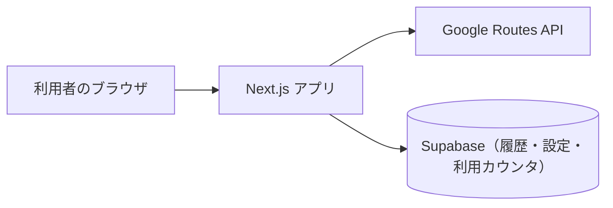
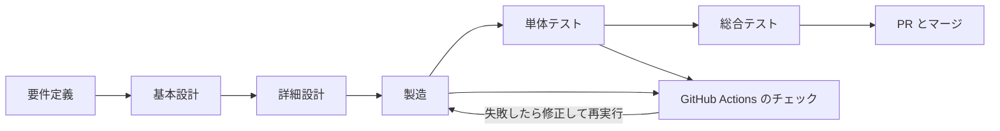

# 電車ルート検索アプリ（Next.js）

現在地（GPS）から目的地まで、今から乗れる次の便を「最安・最短・乗り換え最少」の総合おすすめ順で表示する個人用 Web アプリです。Google Routes API（TRANSIT）のみを使い、無料枠（Essentials SKU：月 10,000 件）の範囲内で動くよう設計しています。

## 作ろうとした理由

- Google マップの通常の検索では、候補を運賃・所要時間・乗り換え回数の自分の重み付けで並べ替えることや、無料枠の利用状況を見ながら使うことができません。
- 出発は現在時刻が既定、現在地から、目的地だけを入力して素早く検索する、という自分の使い方に寄せた形で、無料の範囲内で運営できる個人用アプリとして開発しました。

## 現在の制約（2026-11-18 時点）

- 実データ検索は利用できません。Google Routes API の TRANSIT が日本の公共交通データを返さないことを、発行した実キーで確認しました（DRIVE と WALK は正常に応答）。このため、画面上にも実データ検索が利用できない旨を表示しています。
- モックデータでの検索と表示は利用できます。
- 実データの取得元（SerpApi、ODPT／GTFS など）への切り替えは今後の対応です。

## 技術環境

| 区分 | 内容 |
| --- | --- |
| 言語・基盤 | TypeScript、Next.js 15（App Router）、React 19 |
| デザイン | Tailwind CSS v4 + shadcn/ui（Radix ベースの UI コンポーネント） |
| API | Hono（Next.js の Route Handler 上で /api 配下を担当） |
| 実行環境 | Node.js 20、Docker（Next.js の standalone 出力） |
| 外部サービス | Google Routes API（TRANSIT）、Supabase（PostgreSQL、匿名認証、RLS） |
| テスト | Vitest（単体テスト。カバレッジ 100% を CI で担保） |
| CI | GitHub Actions（型チェック、テスト、ビルド、コーディング規約チェック、ドキュメント形式チェック） |

### Next.js を採用した理由

- 画面（React）と API（Route Handler）を 1 つのプロジェクトと TypeScript で完結でき、API キーをサーバー側に隠したままブラウザから検索できる。
- サーバー側にキャッシュ（同一条件 60 秒）を持てるため、同じ検索の繰り返しで無料枠を消費しない。
- standalone 出力で Docker 化と単体起動が簡単で、個人用の運用に合う。

## 使用した AI エージェント

- 開発は AI エージェント（Muse）との対話で進めました。要件定義と設計ドキュメントの作成、製造、単体テストと総合テストの実施、GitHub での PR 作成とマージ、Supabase のセットアップ補助までを Muse が担当し、条件の決定と最終確認は開発者本人が行いました。
- Muse は本人の Windows PC へ SSH で接続してリポジトリを操作し、ブラウザ操作が必要な場面（GitHub、Supabase）は本人のブラウザと連携して進めました。

### Supabase に関する担当分担

- 開発者本人：Supabase の採用判断、認証方式（端末・ユーザー単位の匿名認証）の決定、自分のアカウントとブラウザを使ったプロジェクト作成の実行。
- Muse：テーブル設計と RLS ポリシーを含む `supabase/schema.sql` の作成、アプリ側のクライアント実装と画面への接続、`.env.local` への接続情報の設定、匿名サインインから履歴保存・RLS による分離までの接続検証。

### プロンプトエンジニアリングの利用箇所

- 要件定義：決定事項を 1 件ずつ提示して確定し、決まっていない点は「要確認」として文書に残す進め方にした。要確認の解消も、選択肢と推奨を提示して選ぶ形にした。
- 製造とテスト：「1 成果物につき 1 コミット」「カバレッジ 100% まで修正する」「共通化できる定義は 1 か所に集約する」など、成果物の粒度と完了条件を指示に含めた。
- 事実確認：公式ページで確認できたことだけを確定情報として記載し、確認できないことは未確認と明記する制約を設けた。

### コンテキストエンジニアリングの利用箇所

- コンテキストエンジニアリングは、プロンプトの書き方ではなく、エージェントに「どの情報を・どの量だけ・どの形で」渡すかを設計する考え方である（Anthropic の「Effective context engineering for AI agents」など）。渡す情報が増えるほど精度が落ちる（コンテキストロット）ため、必要最小限の高品質な情報に絞るのが基本になる。
- 恒常的な前提（ナレッジ）とその回の作業（コンテキスト）の分離：規約や参照先は `AGENTS.md` とドキュメント群に置き、会話ではその回の差分と決定事項だけを扱う。
- ジャストインタイムの取得：ドキュメントはファイル名や番号などの識別子で参照し、必要なものだけを必要なときに読む。全資料を毎回渡さない。
- 構造化ノート（外部メモリ）：決定事項、要確認、テスト結果をドキュメントとコミット履歴に残し、会話が長くなっても状態を再現できるようにした。

### ループエンジニアリングの利用箇所

- CI の反復：GitHub Actions のチェック（型、テスト、カバレッジ、規約、文書形式）が失敗したら原因を直して再 push し、全件成功するまで繰り返した。
- カバレッジの反復：計測して未到達の行を特定し、テストを追加して再計測する反復で、カバレッジ 100% に到達させた。
- テスト工程の反復：観点表の作成、実施、結果の記録、未実施項目の切り分けを、単体テストと総合テストの両方で回した。

### ハーネスエンジニアリングの利用箇所

- リポジトリ直下の `AGENTS.md` に、規約、正の参照先、作業ルールなどの恒常的な前提を集約した。これにより、セッションのたびに同じ情報を渡し直さなくても、エージェントが同じ前提で作業できる。個別のドキュメントが正であり、`AGENTS.md` はその入口に徹する。

### トークン節約のための手法

- 前提の集約：`AGENTS.md` に恒常的な前提を置き、セッションごとの説明を省略する（ハーネスエンジニアリングと共通）。
- 単一の正への参照：共通項目は `docs/11_共通項目定義.md` を正とし、同じ定義を会話や文書で繰り返さない。
- 検証の自動化：確認を GitHub Actions のチェックに寄せ、会話での確認の往復を減らす。
- 差分の最小化：1 成果物 1 コミットで変更を小さく保ち、確認とレビューの対象を絞る。
- 外部メモリの活用：成果物や経過はファイルとコミット履歴に残し、長い内容を会話に貼り直さない。
- 単一エージェント運用：エージェント間で文脈を受け渡すと情報が複製されて消費が増えるため、単一のエージェントで進める（グラフエンジニアリング不使用の理由と共通）。

### グラフエンジニアリング（不使用）

- 複数のエージェントをグラフ状に連携させる方式は採用しなかった。単一のエージェントで進める方がトークン消費を抑えられるためである。

## 構成図

システム構成（実行時）:



開発フロー（CI の反復を含む）:



## ドキュメント

- 要件定義書：`docs/00_要件定義書.md`（§10 にバス・飛行機への拡張要件）
- 基本設計書：`docs/01_基本設計書.md`
- ER 図：`docs/02_ER図.md`／CRUD 図：`docs/03_CRUD図.md`
- 詳細設計書：`docs/04_詳細設計書.md`／SQL 一覧：`docs/05_SQL一覧.md`／物理 ER 図：`docs/06_物理ER図.md`
- バッチ処理定義：`docs/07_バッチ処理定義.md`／クラス図：`docs/08_クラス図.md`／シーケンス図：`docs/09_シーケンス図.md`
- 共通項目定義：`docs/11_共通項目定義.md`
- Supabase 設計：`docs/17_Supabase設計.md`

## セットアップ

1. Google Cloud でプロジェクト作成 → 課金アカウント紐付け → Routes API 有効化 → API キー発行（API 制限＝Routes API のみ）＋クォータ上限設定。
2. `.env.sample` をコピーして `.env.local` を作り、`GOOGLE_MAPS_API_KEY` にキーを入れる（キーはチャット等に貼らない）。`.env.local` は gitignore 済みで Git には上がらない。
3. 起動は次のどちらか。
   - ローカル：`start.bat` をダブルクリック → ブラウザで `http://localhost:3000` を開く（手動の場合：`npm install` → `npm run build` → `npm run start`）
   - Docker：`docker compose up --build` → `http://localhost:3000`
4. キーなしでも「モックデータで試す」で画面確認ができる。

## Supabase のセットアップ（任意）

検索履歴・設定・利用カウンタを端末・ユーザー単位で Supabase に保存する場合の設定。未設定なら localStorage のみで動作する。設計は `docs/17_Supabase設計.md`、テーブルと RLS の定義は `supabase/schema.sql` を参照。

1. Supabase でプロジェクトを作成する（無料枠でよい）。
2. SQL Editor で `supabase/schema.sql` を実行し、テーブルと RLS ポリシーを作る。
3. Authentication の設定で Anonymous Sign-ins（匿名サインイン）を有効化する。
4. Project Settings → API の Project URL と anon key を、`.env.local` の `NEXT_PUBLIC_SUPABASE_URL` と `NEXT_PUBLIC_SUPABASE_ANON_KEY` に入れる。
5. `NEXT_PUBLIC_` 変数はビルド時に埋め込まれるため、アプリを再ビルドして再起動する。

## Docker と展開

- `Dockerfile` は Next.js の standalone 出力を使ったマルチステージビルド。`docker-compose.yml` は `.env.local` を読み込んでポート 3000 で起動する。
- 共有や AWS への展開を想定した構成にしており、コンテナイメージはそのまま ECR へ push して ECS／App Runner 等で動かせる（展開手順は展開先が決まった時点で追加する）。

## 主な仕様

- 出発地デフォルト＝現在地 GPS（座標を緯度経度のまま Routes API へ。追加 API なし）。拒否時は手入力に切替。
- 並び替えデフォルト＝総合おすすめ（運賃 0.4・所要時間 0.3・乗り換え 0.3 の正規化スコア）。運賃不明ルートは先頭にせず、分けて表示。
- 「最安」は API が返した候補のうち運賃が取得できたものの中での最安（IC／特急料金／定期は対象外）。
- 検索 1 回＝API 1 リクエスト。同一条件は 60 秒キャッシュ。月間カウンターが 8,000 件で警告・10,000 件で自動停止（設定変更可）。

## テストとカバレッジ

```text
npm run typecheck       # 型チェック
npm run test            # 単体テスト
npm run test:coverage   # カバレッジ付き（閾値：全指標 100%）
```

カバレッジ対象は `src/features/*/lib/**`、`src/lib/**`、`src/app/api/**`（画面コンポーネントは対象外）。

## CI（GitHub Actions）

push と pull_request で、ドキュメント形式チェック（Docs Check）と、型チェック → カバレッジ付きテスト → 本番ビルド（CI）を実行する。
