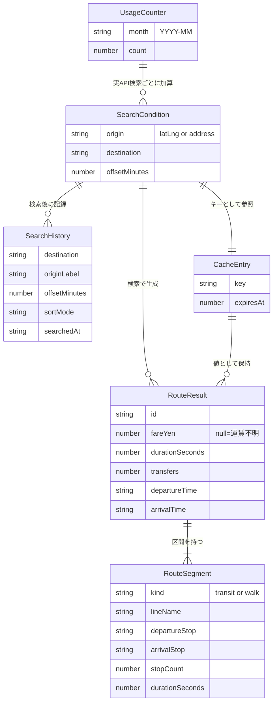

# DB設計書：電車ルート検索アプリ

作成日：2026-11-18／対応要件：docs/00_要件定義書.md、docs/01_基本設計書.md

## 1. 概要・方針

本アプリはデータベース（RDB）を持たない。データはブラウザの localStorage とサーバー側メモリ（キャッシュ）にのみ保持し、再起動や月替わりで自然にリセットされる設計である（根拠：01_基本設計書 §4.2／§5）。
したがって本書では、論理データモデルとしての ER図、物理ストレージ定義（DDL／DML の代替）、CRUD図を定める。

## 2. ER図（論理データモデル）

### 2.1 エンティティ定義

#### SearchCondition（検索条件）

| 属性 | 型 | 保存先 | 備考 |
|---|---|---|---|
| origin | OriginInput（latLng または address の union） | リクエスト内のみ | GPS座標 or 駅名・住所文字列 |
| destination | string | リクエスト内のみ／履歴に複写 | 必須 |
| offsetMinutes | number（0〜180） | リクエスト内のみ／履歴に複写 | 初期値0 |

#### RouteResult（正規化済みルート：NormalizedRoute）

| 属性 | 型 | 保存先 | 備考 |
|---|---|---|---|
| id | string（`route-{index}`） | レスポンスのみ | 応答内の連番 |
| fareYen | number \| null | レスポンスのみ | null = 運賃不明 |
| currencyCode | string? | レスポンスのみ | 通常 JPY |
| durationSeconds | number | レスポンスのみ | |
| distanceMeters | number \| null | レスポンスのみ | |
| departureTime / arrivalTime | string(ISO) \| null | レスポンスのみ | legs の startTime / endTime |
| transfers | number | レスポンスのみ | TRANSITステップ数 − 1（下限0） |
| score | number? | レスポンスのみ（ブラウザで付与） | 総合おすすめ用 |

#### RouteSegment（区間：RouteResult の子）

| 属性 | 型 | 保存先 | 備考 |
|---|---|---|---|
| kind | "transit" \| "walk" | レスポンスのみ | |
| lineName / vehicleType | string? | レスポンスのみ | transit のみ |
| departureStop / arrivalStop | string? | レスポンスのみ | transit のみ |
| departureTime / arrivalTime | string(ISO)? | レスポンスのみ | transitDetails 由来 |
| stopCount | number? | レスポンスのみ | transit のみ |
| durationSeconds | number | レスポンスのみ | |
| distanceMeters | number? | レスポンスのみ | |

#### UsageCounter（月間カウンター）

| 属性 | 型 | 保存先 | 備考 |
|---|---|---|---|
| month | string（YYYY-MM、Asia/Tokyo） | localStorage `tra.usage` | 読取時に月が違えば0へ遅延リセット |
| count | number | localStorage `tra.usage` | 実API・非キャッシュ時のみ加算 |

#### SearchHistory（検索履歴）

| 属性 | 型 | 保存先 | 備考 |
|---|---|---|---|
| destination | string | localStorage `tra.history` | |
| originLabel | string | localStorage `tra.history` | 表示用（「現在地」または住所文字列） |
| origin | OriginInput | localStorage `tra.history` | 再検索用 |
| offsetMinutes | number | localStorage `tra.history` | |
| sortMode | SortMode | localStorage `tra.history` | |
| searchedAt | string(ISO) | localStorage `tra.history` | 最大10件、新しい順 |

#### CacheEntry（サーバー側キャッシュ）

| 属性 | 型 | 保存先 | 備考 |
|---|---|---|---|
| key | string | サーバーメモリ（Map） | 検索条件の安定文字列化 |
| value | RouteResult[] | サーバーメモリ | 正規化済み配列 |
| expiresAt | number（epoch ms） | サーバーメモリ | 登録時刻 + 60秒。取得時に期限切れを破棄 |

#### Settings（設定：参考）

warnAt（初期8000）／stopAt（初期10000）を localStorage `tra.settings` に保存。出発地の前回値は localStorage `tra.originText`。

### 2.2 ER図（Mermaid）

### 2.3 備考

- リレーションはすべて実行時の生成・参照関係であり、外部キー制約等は存在しない。
- サーバー側に残るのは CacheEntry のみで、再起動で消える。永続データはすべてユーザーのブラウザ内（localStorage）に閉じる。

## 3. DDL／DML

### 3.1 DDL／DML を作成しない理由

- RDB を導入しないため、テーブル定義言語（DDL）およびデータ操作言語（DML）の対象が存在しない。
- 永続データはすべてユーザーのブラウザ内（localStorage）に閉じ、サーバー側に残るのは TTL 60秒のメモリキャッシュのみである。

### 3.2 物理ストレージ定義（DDL 代替）

localStorage のキーと値の形式を、物理スキーマ相当として定める。

| キー | 値の形式（JSON） | 用途 |
|---|---|---|
| `tra.usage` | `{ "month": "YYYY-MM", "count": number }` | 月間カウンター（UsageCounter） |
| `tra.history` | SearchHistory の配列（最大10件、新しい順） | 検索履歴 |
| `tra.settings` | `{ "warnAt": number, "stopAt": number }` | 警告／停止件数（初期値 8000／10000） |
| `tra.originText` | string | 出発地の前回入力値 |

サーバー側メモリのキャッシュ（CacheEntry）はプロセス内 Map で保持し、キー=検索条件の安定文字列化、値=正規化済みルート配列、TTL=60秒とする。永続化はしない。

### 3.3 データ操作（DML 代替）

- 参照・登録・更新・削除の対応は次節の CRUD図に従う。
- UsageCounter の「削除」は行わず、月替わりは読取時の遅延リセットで代替する。
- SearchHistory の削除は、最大件数（10件）超過時に古いものから押し出す方式とし、明示的な削除操作は設けない。

## 4. CRUD図

凡例：C=Create（作成）／R=Read（参照）／U=Update（更新）／D=Delete（削除）／－=なし

| 機能 \ エンティティ | SearchCondition | RouteResult | RouteSegment | UsageCounter | SearchHistory | CacheEntry |
|---|:---:|:---:|:---:|:---:|:---:|:---:|
| ルート検索（実API） | R | C | C | U（+1） | C | C |
| ルート検索（キャッシュ命中） | R | R | R | － | C | R |
| ルート検索（モック） | R | C | C | － | C | － |
| 並び替え変更 | － | R | R | － | － | － |
| 履歴保存 | R | － | － | － | C | － |
| 履歴から再検索 | C（復元） | C／R | C／R | U（実API・非キャッシュ時+1） | C | R／C |
| カウンター加算 | － | － | － | U | － | － |
| カウンター月次リセット | － | － | － | U（読取時に遅延リセット） | － | － |
| キャッシュ参照／登録 | R | R／C | R／C | － | － | R／C |
| キャッシュ期限切れ破棄 | － | － | － | － | － | D |
| 設定変更（警告／停止件数） | － | － | － | R | － | － |
| GPS取得・出発地手入力 | C（条件として組み立て） | － | － | － | － | － |

### 4.1 備考

- RouteResult / RouteSegment はサーバー応答として都度生成される（C）だけで、永続化も削除もされない（レスポンスのみ）。
- SearchHistory は最大10件で、超過分は古いものから押し出される（実質Dだが、明示的な削除UIは持たない）。
- UsageCounter の D はない。月の切り替わりは削除ではなく「読取時に当月0件として扱う」遅延リセット（U相当）。
- CacheEntry の削除は TTL（60秒）到達時の取得時破棄のみ。定期掃除バッチは持たない（01_基本設計書 §5）。
- SearchCondition 自体は保存されない。再検索に必要な分だけ SearchHistory へ複写される。
