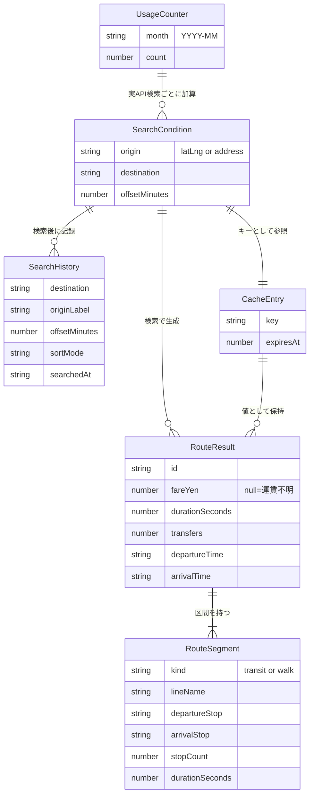

# ER図（論理データモデル）：電車ルート検索アプリ

本アプリは DB を持たない。以下は「エンティティ」として扱うデータ構造の論理モデルであり、保存先はメモリ／localStorage／レスポンスのみ。物理テーブルは存在しない。

## 1. エンティティ定義

### SearchCondition（検索条件）

| 属性 | 型 | 保存先 | 備考 |
|---|---|---|---|
| origin | OriginInput（latLng または address の union） | リクエスト内のみ | GPS座標 or 駅名・住所文字列 |
| destination | string | リクエスト内のみ／履歴に複写 | 必須 |
| offsetMinutes | number（0〜180） | リクエスト内のみ／履歴に複写 | 初期値0 |

### RouteResult（正規化済みルート：NormalizedRoute）

| 属性 | 型 | 保存先 | 備考 |
|---|---|---|---|
| id | string（`route-{index}`） | レスポンスのみ | 応答内の連番 |
| fareYen | number \| null | レスポンスのみ | null = 運賃不明 |
| currencyCode | string? | レスポンスのみ | 通常 JPY |
| durationSeconds | number | レスポンスのみ | |
| distanceMeters | number \| null | レスポンスのみ | |
| departureTime / arrivalTime | string(ISO) \| null | レスポンスのみ | legs の startTime / endTime |
| transfers | number | レスポンスのみ | TRANSITステップ数 − 1（下限0） |
| score | number? | レスポンスのみ（ブラウザで付与） | 総合おすすめ用 |

### RouteSegment（区間：RouteResult の子）

| 属性 | 型 | 保存先 | 備考 |
|---|---|---|---|
| kind | "transit" \| "walk" | レスポンスのみ | |
| lineName / vehicleType | string? | レスポンスのみ | transit のみ |
| departureStop / arrivalStop | string? | レスポンスのみ | transit のみ |
| departureTime / arrivalTime | string(ISO)? | レスポンスのみ | transitDetails 由来 |
| stopCount | number? | レスポンスのみ | transit のみ |
| durationSeconds | number | レスポンスのみ | |
| distanceMeters | number? | レスポンスのみ | |

### UsageCounter（月間カウンター）

| 属性 | 型 | 保存先 | 備考 |
|---|---|---|---|
| month | string（YYYY-MM、Asia/Tokyo） | localStorage `tra.usage` | 読取時に月が違えば0へ遅延リセット |
| count | number | localStorage `tra.usage` | 実API・非キャッシュ時のみ加算 |

### SearchHistory（検索履歴）

| 属性 | 型 | 保存先 | 備考 |
|---|---|---|---|
| destination | string | localStorage `tra.history` | |
| originLabel | string | localStorage `tra.history` | 表示用（「現在地」または住所文字列） |
| origin | OriginInput | localStorage `tra.history` | 再検索用 |
| offsetMinutes | number | localStorage `tra.history` | |
| sortMode | SortMode | localStorage `tra.history` | |
| searchedAt | string(ISO) | localStorage `tra.history` | 最大10件、新しい順 |

### CacheEntry（サーバー側キャッシュ）

| 属性 | 型 | 保存先 | 備考 |
|---|---|---|---|
| key | string | サーバーメモリ（Map） | 検索条件の安定文字列化 |
| value | RouteResult[] | サーバーメモリ | 正規化済み配列 |
| expiresAt | number（epoch ms） | サーバーメモリ | 登録時刻 + 60秒。取得時に期限切れを破棄 |

### Settings（設定：参考）

warnAt（初期8000）／stopAt（初期10000）を localStorage `tra.settings` に保存。出発地の前回値は localStorage `tra.originText`。

## 2. ER図（Mermaid）

## 3. 備考

- リレーションはすべて実行時の生成・参照関係であり、外部キー制約等は存在しない。
- サーバー側に残るのは CacheEntry のみで、再起動で消える。永続データはすべてユーザーのブラウザ内（localStorage）に閉じる。
