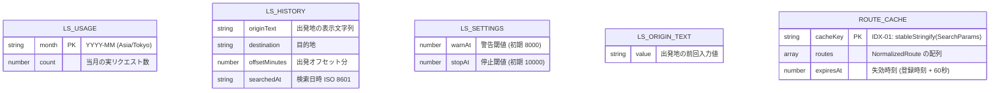

# 物理ER図：電車ルート検索アプリ

作成日：2026-11-18／対応文書：docs/02_ER図.md（論理モデル）、docs/11_共通項目定義.md（キー・インデックス定義の正）

## 1. 物理ストアの構成

論理モデル（docs/02）に対する物理実装は、ブラウザの localStorage（JSON 文字列）とサーバー側メモリ（Map）の 2 ストアである。RDB のテーブルは存在しない。

| 物理ストア | 実体 | 永続性 |
|---|---|---|
| LS_USAGE | localStorage キー tra.usage | ブラウザに永続 |
| LS_HISTORY | localStorage キー tra.history | ブラウザに永続 |
| LS_SETTINGS | localStorage キー tra.settings | ブラウザに永続 |
| LS_ORIGIN_TEXT | localStorage キー tra.originText | ブラウザに永続 |
| ROUTE_CACHE | サーバー側 Map（プロセス内） | プロセス終了で消滅、TTL 60 秒 |

## 2. 物理ER図（Mermaid）

## 3. 論理モデルとの対応

| 論理エンティティ（docs/02） | 物理ストア | 備考 |
|---|---|---|
| UsageCounter | LS_USAGE | month が実質の主キー（IDX-02） |
| SearchHistory | LS_HISTORY | 配列の並び順が IDX-03 |
| Settings | LS_SETTINGS | 1 レコードのみ |
| （出発地の前回値） | LS_ORIGIN_TEXT | 単一文字列 |
| CacheEntry | ROUTE_CACHE | 主キーは IDX-01 |
| SearchCondition／RouteResult | 物理ストアなし | リクエスト／レスポンス内の一時データ |

## 4. 制約

- ストア間に外部キーや参照整合性はない（各ストアは独立）。
- LS_HISTORY は最大 10 件。超過分は登録時に末尾から削除する（docs/05_SQL一覧.md OP-05）。
- ROUTE_CACHE は永続化しない。再起動で消えることを前提とする。
- インデックス定義の正は docs/11_共通項目定義.md §2 とする。本書はその参照のみを行う。
