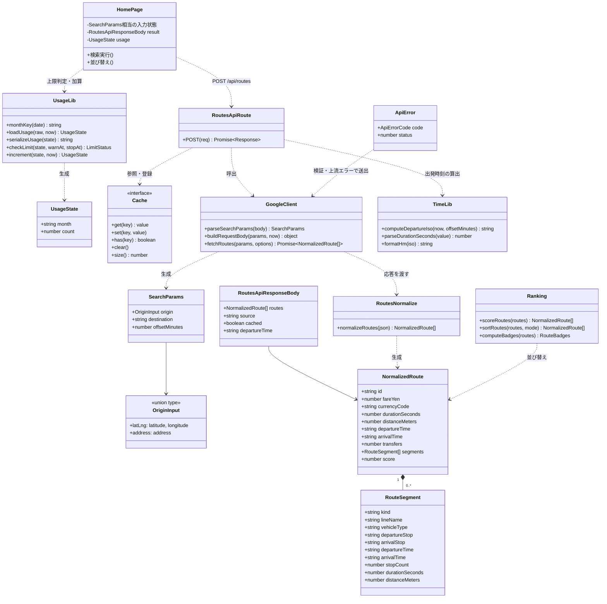

# クラス図：電車ルート検索アプリ

作成日：2026-11-18／対応文書：docs/04_詳細設計書.md、src/lib 配下の実装

## 1. 型とモジュールのクラス図（Mermaid）

## 2. 備考

- 本アプリは関数型のモジュール構成であり、クラスは ApiError と型定義（interface）が中心である。本図ではモジュールをクラス相当として表記した。
- Cache は Cache<T> インターフェースで、実装は createCache 関数が返すオブジェクトである。
- 型の正は src/lib/types.ts、モジュールの責務は docs/04_詳細設計書.md §2 を参照。
