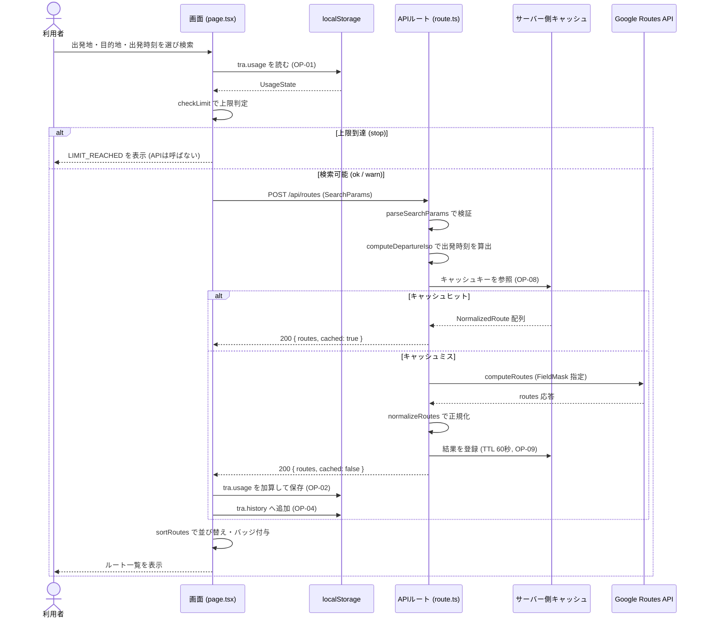
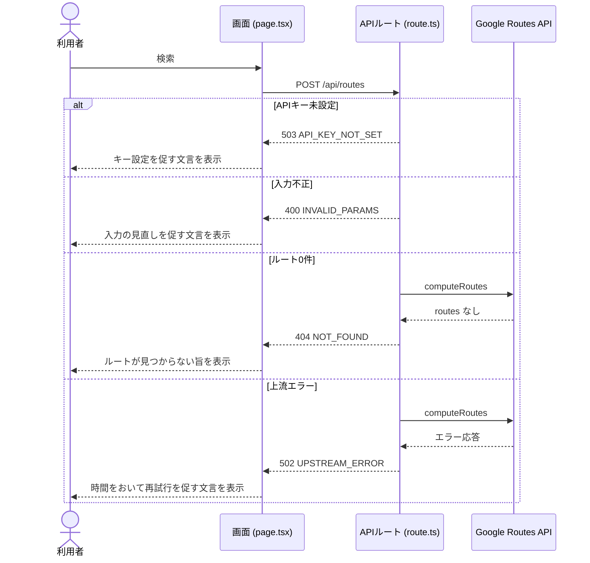
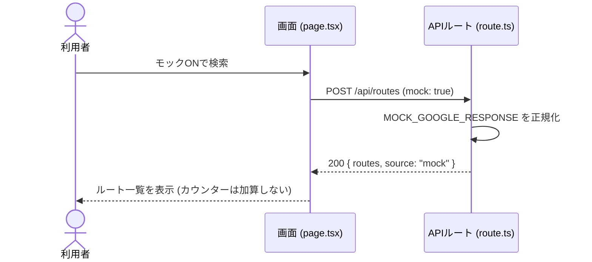

# シーケンス図：電車ルート検索アプリ

作成日：2026-11-18／対応文書：docs/04_詳細設計書.md §2.8・§2.9

## 1. 検索の基本フロー

## 2. エラー時のフロー

## 3. モックモードのフロー

## 4. 備考

- カウンター加算（OP-02）と履歴追加（OP-04）は、実 API の検索が成功したときだけ行う。キャッシュヒット時は加算しない。
- GPS で出発地が取れない場合は、画面側で手入力へフォールバックする（docs/00 §5.2）。
